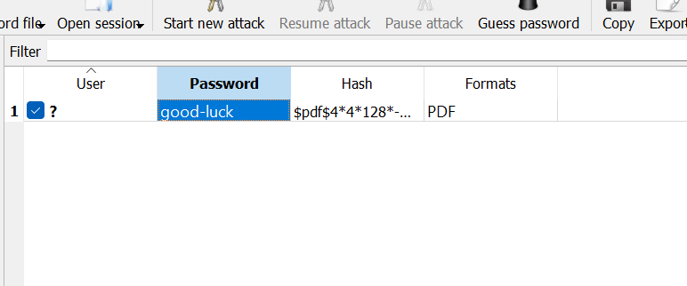
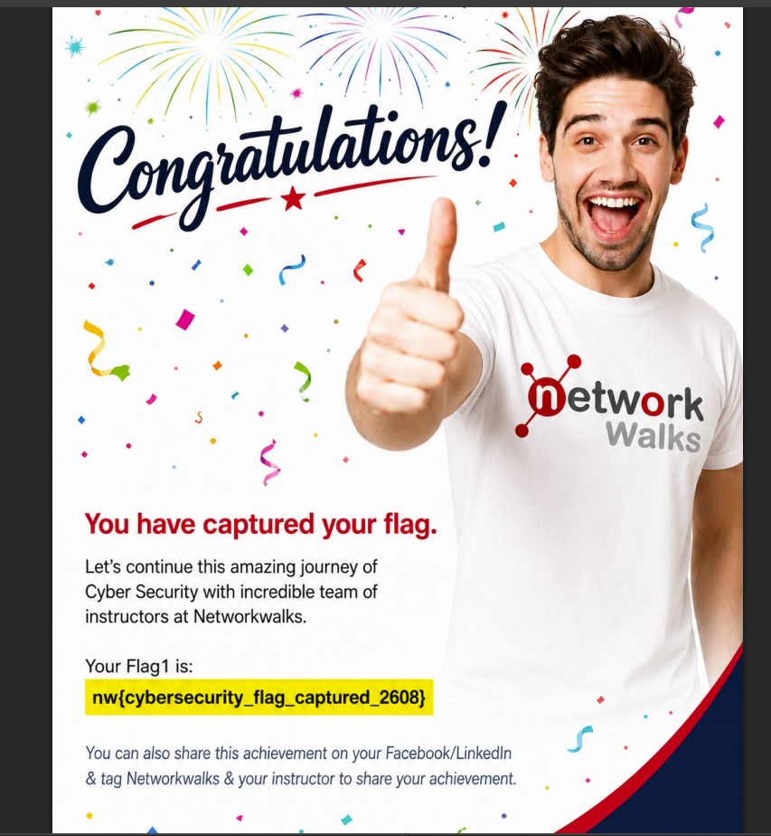
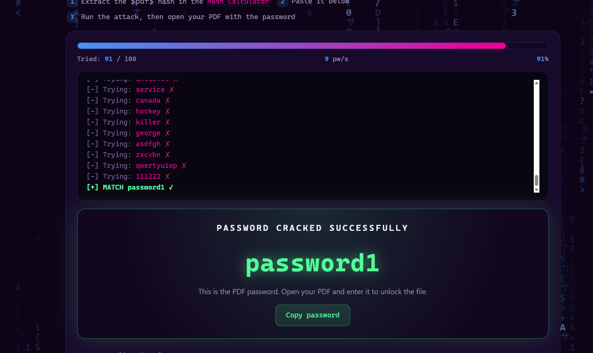
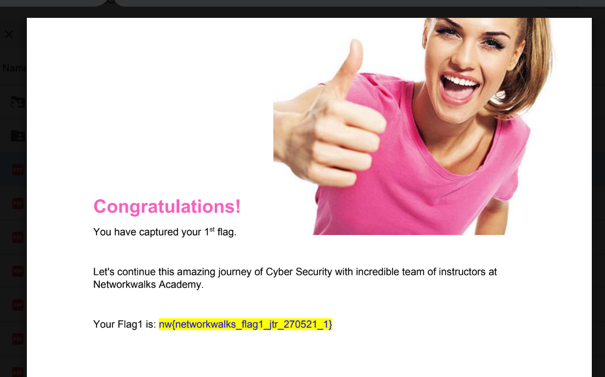

# 🔐 Week 3 – Password Cracking Lab

## 📌 Project Overview

This repository documents my Week 3 Cybersecurity practical lab, focused on PDF password recovery using two different approaches.

The lab involved working with an authorized password-protected PDF file and exploring hash extraction and wordlist-based password recovery techniques.

## 🎯 Objectives

- Understand PDF password protection and hash extraction.
- Practice password recovery using John the Ripper.
- Configure and use Johnny GUI.
- Extract PDF hashes using Networkwalks Hash Calculator.
- Perform password recovery using Networkwalks Password Cracker.

## 🛠️ Tools & Environment

| Tool | Purpose |
|---|---|
| John the Ripper (JTR) | Password recovery |
| Johnny GUI | Graphical interface for John the Ripper |
| Networkwalks Hash Calculator | PDF hash extraction |
| Networkwalks Password Cracker | Wordlist-based password recovery |
| Windows 11 | Operating system |

---

## 🧪 Module 1: Password Cracking with John the Ripper

### Procedure

1. Downloaded and extracted John the Ripper.
2. Installed and configured Johnny GUI.
3. Located the `john.exe` executable in the JTR `run` folder.
4. Extracted the PDF hash.
5. Saved the hash in a text file.
6. Loaded the hash into Johnny.
7. Started the password recovery attack.
8. Successfully recovered the PDF password.

### Screenshots

**1. John the Ripper – Password Recovery Setup**

**2. Successfully Recovered Password Using JTR**

---

## 🌐 Module 2: Password Cracking with Networkwalks Tools

### Procedure

1. Opened Networkwalks Hash Calculator.
2. Uploaded the same authorized lab PDF.
3. Extracted the PDF hash.
4. Copied the generated hash.
5. Opened Networkwalks Password Cracker.
6. Submitted the hash and ran the recovery process.
7. Successfully recovered the PDF password.

### Screenshots

**3. PDF Hash Extraction – Networkwalks**

**4. Successfully Recovered Password – Networkwalks**

---

## ✅ Project Results

Both practical modules were completed successfully.

- John the Ripper and Johnny GUI successfully recovered the PDF password.
- Networkwalks Hash Calculator was used to extract the PDF hash.
- Networkwalks Password Cracker successfully recovered the password.

This practical exercise provided hands-on experience with PDF hash extraction, password recovery, and wordlist-based attack techniques.

## 📚 Key Learning Outcomes

- Understanding how password-protected PDF files are handled.
- Learning how to extract and work with PDF hashes.
- Using command-line and graphical password recovery tools.
- Understanding the role of wordlists in password recovery.
- Comparing two different password recovery workflows.

## ⚠️ Disclaimer

This project was conducted strictly for educational purposes using an authorized lab file. The techniques demonstrated were not used against unauthorized accounts, systems, or files.

---

**Project:** Week 3 Cybersecurity Lab  
**Platform:** Windows 11  
**Focus:** PDF Password Recovery
